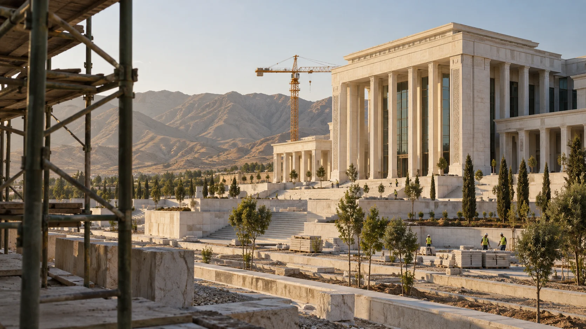

# Gerçek Ýigit Website

Multilingual (EN / RU / TKM) corporate website for **Gerçek Ýigit**, covering textile, construction and machinery services, projects, news, gallery, certificates and catalogues. It includes an admin panel for managing content.

## Gallery

<p align="center">
  
  
</p>
<p align="center">
  
  
</p>
<p align="center">
  
  
</p>

*Images are representative AI-generated content.*

## Tech stack

- PHP 8+ (PDO, `mbstring`, `fileinfo`, OpenSSL)
- MySQL / MariaDB (`utf8mb4`)
- Vanilla JavaScript and CSS (no Node build step)
- PHPMailer (via Composer) for SMTP mail

## Features

- Three languages with a cookie-based language switcher
- Light / dark theme with system-preference detection
- Home page with video intro and sector previews
- Pages: about, services, projects, news, gallery, certificates, catalogues, search, contact, subscribe
- Admin panel in `admin/` for managing content

## Project structure

```
index.php        Front controller
pages/           Page templates
inc/             Shared helpers, language and content files
css/ js/ img/    Static assets
media/           Videos
admin/           Admin panel
database/        SQL migrations
config.php       Configuration (reads environment variables)
```

## Local development

1. Start a MariaDB instance and import your database dump into `gercekyigit_site`.
2. Apply the migrations in `database/migrations/`.
3. Run the PHP built-in server:

```bash
GERCEK_PRODUCTION_MODE=0 GERCEK_DB_HOST=127.0.0.1 GERCEK_DB_PORT=3307 \
GERCEK_DB_NAME=gercekyigit_site GERCEK_DB_USER=<user> GERCEK_DB_PASS=<password> \
php -S 127.0.0.1:8765
```

Open http://127.0.0.1:8765/index.php

## Configuration

Set these environment variables (they take priority over any private config file):

| Variable | Description |
| --- | --- |
| `GERCEK_PRODUCTION_MODE` | `1` in production (hides PHP errors) |
| `GERCEK_DB_HOST` / `GERCEK_DB_PORT` | Database host and port |
| `GERCEK_DB_NAME` | Database name |
| `GERCEK_DB_USER` / `GERCEK_DB_PASS` | Database credentials |

## Deployment

See [DEPLOYMENT.md](DEPLOYMENT.md) for details (in Turkish). In short: upload this directory to an HTTPS web root, provide the environment variables, keep database dumps outside the web root, and transfer `admin/uploads/` separately (it is not stored in this repository).

## Notes

Generated images and videos are representative AI-generated content, not real company photography.
